<picture>
  <source media="(prefers-color-scheme: dark)" srcset="https://raw.githubusercontent.com/nickycodognotto/nickycodognotto/output/github-snake-dark.svg">
  <source media="(prefers-color-scheme: light)" srcset="https://raw.githubusercontent.com/nickycodognotto/nickycodognotto/output/github-snake-purple.svg">
  
</picture>

<p align="center">
  
</p>

<h1 align="center">Nícolas Codognotto</h1>
<p align="center">
  
</p>

<p align="center">
  <a href="mailto:nicolascodognotto@gmail.com"></a>
  <a href="https://www.linkedin.com/in/n%C3%ADcolas-codognotto-1bba4a240/" target="_blank"></a>
  <a href="https://www.nicolascodognotto.com.br" target="_blank"></a>
  <a href="https://instagram.com/nicko.codognotto" target="_blank"></a>
  <br>
  
</p>

<br>

## 🌙 About Me

<table>
<tr>
<td width="60%" valign="top">

```js
const nicolas = {
  role: "Full Stack Software Engineer",
  location: "São Paulo, BR 🌎",
  currentJob: "CSDBR",

  stack: {
    languages: ["Python", "JavaScript", "Clojure"],
    frontend: ["React", "Next.js"],
    backend: ["Django", "Flask", "Node.js"],
    databases: ["PostgreSQL", "Cassandra", "MySQL"],
    cloud: ["Docker", "AWS", "Kafka"],
  },

  exploring: ["LLM APIs", "GitHub Copilot", "AI Agents"],

  motto: "Código limpo, café forte, céu estrelado ✨",
};
```

</td>
<td width="40%" align="center" valign="top">
  
  <br><sub>meu companheiro de código 🦆</sub>
</td>
</tr>
</table>

<br>

## 🛠️ Tech Stack

<p align="center">
  <br>
  <br>
  <br>
  
</p>

<p align="center">
  
  
  
</p>

<br>

## 📊 GitHub Analytics

<p align="center">
  
  
</p>

<p align="center">
  
</p>

<p align="center">
  
  
  
  
  
</p>

<br>

## 🌌 Projetos

| Projeto | Descrição | Stack |
|---|---|---|
| [Portfólio](https://www.nicolascodognotto.com.br/) | Meu site pessoal |  |
| [Jogo da memória](https://github.com/nickycodognotto/jogo_memoria) | Jogo da memória no navegador |  |
| [Calculadora Flask](https://github.com/nickycodognotto/calculadora_flask) | Calculadora web em Flask |  |
| [AgroTech](https://github.com/LuisFernando1625R/AgroTech) | Projeto em equipe | — |

<p align="center">
    
</p>

<br>

<p align="center">
  
</p>

<p align="center">
    <a href="mailto:nicolascodognotto@gmail.com"></a>
    <a href="https://www.linkedin.com/in/n%C3%ADcolas-codognotto-1bba4a240/" target="_blank"></a>
    <a href="https://www.nicolascodognotto.com.br" target="_blank"></a>
    <a href="https://instagram.com/nicko.codognotto" target="_blank"></a>
</p>

<p align="center">
  
  <br><sub>obrigado pela visita ✨</sub>
</p>
